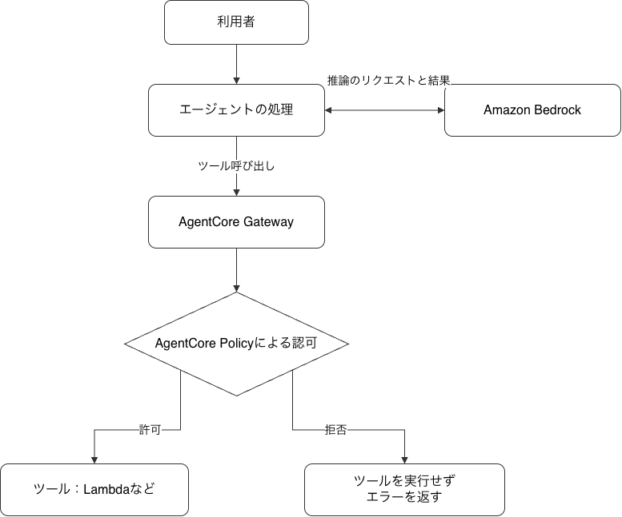

# AIエージェントにどこまで任せるか：AWSで考える認可とガードレール

<div class="flush-right">みどり @ryder472</div>

## はじめに

AIエージェントにツールを使わせるとき、どこまで操作を任せてよいかを考える必要があります。例えば、情報の読み取りは許可しても、削除は禁止したい、更新は条件付きで許可したい、といった場面です。AWSでエージェントを開発するうえで、どの操作を、誰に、どういう条件で許可するかをまとめておきたいと考えました。

本章では、AWSリソースへのアクセスを管理するIAM、認可ポリシーを書くためのCedarとDogwood、ポリシーを適用するAgentCore Policyを取り上げます。文書を更新するツールを例に、Amazon Bedrock Guardrailsで更新内容を検査するところまで見ていきます。

対象読者は、AWSの基礎を知っていて、AIエージェントの認可や安全機構について学びたい方です。「何を、どこで制御するのか」を一緒に考えていければと思います。

## AWSでAIエージェントを動かす全体像

まず、Amazon BedrockとAmazon Bedrock AgentCoreの役割を見ていきます。

### Amazon Bedrockとは

Amazon Bedrockは、さまざまな基盤モデルをAPIから利用できるAWSのマネージドサービスです。基盤モデルとは、大量のデータで事前学習され、さまざまな用途に利用できるAIモデルのことです。大規模言語モデル（LLM）もその一種で、文章の生成や要約、質問への回答などに利用できます。モデルを動かすサーバーを自分で用意せずに、アプリケーションへ生成AIの機能を組み込めます。

### Amazon Bedrock AgentCoreとは

Amazon Bedrock AgentCoreは、AIエージェントの開発・実行・運用を支援するサービス群です。エージェントやツールを動かすRuntime、ツールへの接続を担うGateway、操作の認可ルールを適用するPolicyなどがあり、必要な機能を組み合わせて利用できます。利用するモデルや開発フレームワークに応じて構成でき、Bedrock以外のモデルにも対応しています。

### ツールの呼び出しと制御の流れ

ここでは、エージェントがBedrockを通じてLLMに問い合わせ、必要なツールと引数を選び、ツールの実行結果を次の判断や回答に使う構成を考えます。

本章では、ツールの呼び出しをGatewayに集め、そこにAgentCore Policyのポリシーエンジンを関連付けます。エージェントとGatewayの間では、ツールの一覧取得や呼び出しにModel Context Protocol（MCP）を使います。

<figure>
  
  <figcaption>AgentCore Gatewayでツール呼び出しを認可する流れ</figcaption>
</figure>

図の構成では、エージェントがBedrockに推論を依頼し、Gateway経由でツールを呼び出します。`ENFORCE`モードでは、GatewayはAgentCore Policyが許可した呼び出しをツールに渡し、実行結果をエージェントに返します。拒否した場合は、ツールを呼ばずにエラーを返します。

エージェントの実行場所はRuntimeやローカル環境などから選べます。最初の検証では、LLMやRuntimeを組み込まず、検証クライアントからGatewayを直接呼び出して認可の動作を確かめます。

### 今回使うIAMの基本

AWS Identity and Access Management（IAM）は、AWSリソースへのアクセスを管理する仕組みです。ここでは、認証と認可、IAMポリシー、IAMロールを押さえておきます。

IAMポリシーは、操作の許可・拒否を記述するJSON形式の文書です。例えば、`Action`で操作、`Resource`で対象リソース、`Effect`で許可（`Allow`）・拒否（`Deny`）を指定し、必要に応じて`Condition`で条件を加えます。今回の構成では、呼び出し元に対象のGatewayへの`bedrock-agentcore:InvokeGateway`を許可します。

IAMロールは、人やAWSサービスが引き受けて使うIAMのアイデンティティです。ロールを引き受けると、一時的な認証情報でその権限を利用できます。ロールでは「誰が引き受けられるか」を信頼ポリシーで、「引き受けた後に何をできるか」を権限ポリシーで定義します。例えば、ツールの処理を担うAWS Lambdaの実行ロールでは、Lambdaサービスがロールを引き受けられるようにし、関数の処理に必要な権限を付けます。

IAMロールとIAMポリシーの違いを整理すると、次のようになります。

<figure class="tbl">
  <figcaption>IAMロールとIAMポリシーの役割</figcaption>

| 用語 | 役割 | 今回の例 |
| --- | --- | --- |
| IAMロール | 人やサービスが引き受け、一時的な認証情報で権限を利用するためのもの | Gatewayのサービスロール、Lambdaの実行ロール |
| IAMポリシー | 操作の許可・拒否や条件を記述するルール | Gatewayのロールに付ける、対象Lambdaの呼び出しを許可する権限ポリシー |

</figure>

例えば、Gatewayはサービスロールを引き受け、そのロールに付けた権限ポリシーに基づいてLambdaを呼び出します。「Gatewayが使うロール」と「そのロールに何を許可するかを書くポリシー」を分けると、設定の関係を追いやすくなります。信頼ポリシーもポリシーの一種で、ロールを誰が引き受けられるかを定める役割があります。

ここで、認証と認可を分けて考えます。認証は呼び出し元を確かめること、認可はその呼び出し元に操作を許可するかを判断することです。例えば、IAM認証のGatewayでは、呼び出し元のIAM認証情報と権限を使ってGatewayへのアクセスを制御します。そのうえで、AgentCore Policyによって、対象ツールや引数などに応じた条件を追加します。

<figure class="tbl">
  <figcaption>ツール呼び出しに関わるアクセス制御</figcaption>

| 制御する場所 | 本章で扱う例 |
| --- | --- |
| 呼び出し元からGatewayへのアクセス | IAMで、対象Gatewayの呼び出しを許可する |
| Gatewayを通るツール呼び出し | AgentCore Policyで、指定した呼び出し元による文書 `report` の更新を許可する |
| GatewayからLambdaへのアクセス | Gatewayのサービスロールに、対象Lambdaを呼ぶ権限を付ける |
| LambdaからCloudWatch Logsへのアクセス | Lambdaの実行ロールに、実行マーカーを書き込む権限を付ける |

</figure>

Gatewayから接続先へのアクセスには、接続先に応じた認証情報や権限も必要です。ここではLambdaを例に、呼び出し元、Gateway、Lambdaが使う権限を分けて扱います。

また、この構成でPolicyが制御するのは、Gatewayを通る操作です。別の経路からツールを直接呼べる権限があれば、その経路も確認する必要があります。IAMでAWSリソースへのアクセス範囲を絞りながら、Gatewayでは個々のツール呼び出しに条件を設ける、という組み合わせで考えていきます。

ここで扱ったIAMポリシーと、次に扱うCedarのポリシーは別の形式です。IAMでAWSへのアクセス権限を設定し、AgentCore PolicyではCedarなどで記述したルールを使ってツール呼び出しを制御します。次は、その認可ルールを記述するためのCedarを見ていきます。

## Cedarで認可ルールを書く

### Cedarとは

Cedarは、認可ポリシーを記述し、操作を許可するか拒否するかを判断するための言語です。IAMポリシーとは構文や評価モデルが異なります。ここでは、Cedarの基本を小さな例で整理します。

Cedarの認可リクエストには、次の4つの要素があります。

<figure class="tbl">
  <figcaption>Cedarの認可リクエストを構成する要素</figcaption>

| 要素 | 意味 | 今回の例 |
| --- | --- | --- |
| principal | 操作を行う主体 | `User::"alice"` |
| action | 実行したい操作 | `Action::"update"` |
| resource | 操作の対象 | `Document::"report"` |
| context | リクエスト時の追加情報 | 承認済みか、更新をロックしているか |

</figure>

`User::"alice"`は、`User`という型と`alice`というIDで主体を表したものです。同様に、操作と対象も型とIDで表します。contextは、評価時に呼び出し側から渡す追加情報です。これらに加え、主体や対象の属性・所属関係などのエンティティデータも評価に利用できます。

### permitで条件付きの許可を書く

例えば、「aliceがreportを更新する操作を、承認済みの場合に許可する」というルールは、次のように記述します。

```cedar
permit (
    principal == User::"alice",
    action == Action::"update",
    resource == Document::"report"
)
when {
    context.approved == true
};
```

`permit`は許可を表します。括弧内で対象となる主体・操作・リソースを絞り、`when`で追加条件を指定しています。この例では、contextに真偽値の`approved`を渡し、その値が`true`の場合に許可します。

ただし、呼び出し元が自由に`approved`を指定できるなら、実際の承認を証明できません。実装では、承認の状態を信頼できる処理から取得し、評価に渡す必要があります。これは例を業務へ適用する際の設計上の注意点です。

### forbidと判定の基本

<div class="break-inside-avoid">

さらに、「文書 `report` の更新がロックされている間は、どの主体からの更新も拒否する」というルールを追加します。

```cedar
forbid (
    principal,
    action == Action::"update",
    resource == Document::"report"
)
when {
    context.locked == true
};
```

</div>

主体を`principal`だけで指定すると、その箇所では主体を限定しません。`forbid`は明示的な拒否を表します。Cedarでは、該当する`forbid`があれば、`permit`にも該当していても拒否されます。また、該当する`permit`がなければ拒否されます。記述の順序で優先順位が決まるわけではありません。

この2つのポリシーだけを評価し、主体・操作・対象が最初の例と同じである場合、次の判定になります。Cedar WASM 4.12.0で、架空のリクエストを使って表4の3ケースをローカル確認しました。

<figure class="tbl">
  <figcaption>Cedarによる文書更新の認可結果</figcaption>

| `approved` | `locked` | 判定結果 | 理由 |
| --- | --- | --- | --- |
| true | false | 許可 | permitに該当し、forbidに該当しない |
| false | false | 拒否 | 該当するpermitがない |
| true | true | 拒否 | forbidに該当する |

</figure>

型や属性の取り違えを防ぐためには、スキーマでエンティティやcontextの構造、操作に対応する主体・対象の型などを定義し、ポリシーを検証します。この例では、`approved`と`locked`を真偽値として定義し、評価時にも渡す前提です。スキーマに合うことと、業務上のルールが正しいことは、それぞれ確認する必要があります。

なお、属性の欠落などで評価エラーになったポリシーは、Cedarの判定から除外されます。Cedarは、どのポリシーで何のエラーが起きたかを、認可の判定と一緒に返します。

### 個人への許可から、所属と属性による許可へ

aliceだけを指定する例は分かりやすい一方、利用者が増えると、個人ごとに同じポリシーを書く必要が出てきます。例えば「編集者グループに所属し、文書と同じ部署の利用者が、承認済みの更新を行える」という形にしてみます。この例はalice限定のpermitを置き換え、対象を同じ部署に属する文書へ広げます。report以外でもロックによる拒否が必要なら、forbidの対象も広げます。Cedar WASM 4.12.0で学習用のスキーマを使い、構文・型と所属・部署による判定を確認しました。

```cedar
permit (
    principal in Group::"editors",
    action == Action::"update",
    resource is Document
)
when {
    principal.department == resource.department &&
    context.approved == true
};
```

`in` はエンティティの所属関係を調べます。例えば、`User` が `Group` に所属する関係をエンティティデータで渡します。`resource is Document` は対象を `Document` 型に限定します。また、`department` は主体と文書の属性です。文書の部署は、管理している文書情報から取得する設計にします。

この例を検証するスキーマには、Userの所属先となるGroup、UserとDocumentの文字列属性department、updateに対応する主体・対象・contextの型を定義します。スキーマは構造を定義するもので、aliceが実際に編集者かどうかというデータを登録するものではありません。ポリシー、スキーマ、エンティティデータを分けて用意します。

### ポリシーを追加すると、何が広がるか

複数のpermitは、「すべて満たすべき条件」として自動的に結合されません。承認を要求するpermitを追加しても、既存の承認不要なpermitが適用されれば、forbidがない限り許可されます。条件を厳しくするつもりでpermitを追加するときは、以前のpermitを置き換える必要がないか確認します。

評価エラーについても、先ほどのロック用forbidで考えてみます。aliceの更新を許可するpermitが成立していても、`context.locked`が欠落すると、ロック用forbidは評価エラーになります。このforbidが除外され、他に成立するforbidがなければ、Cedarの一般的な評価規則では許可され得ます。これはAgentCoreが同じ入力を受け付けることを意味せず、Cedarの規則を理解するための例です。

任意属性を参照するときは、`has`で存在を確認してから値を比較できます。例えば、permit側で`context has approved && context.approved == true`とすれば、approvedがない場合にこの許可条件は成立しません。ただし、別のpermitによる許可までは防げません。欠落を必ず拒否する設計にするなら、評価前の必須項目検査や、欠落時も成立する拒否条件を含めて考えます。

検証では、値のtrue／falseに加えて、属性欠落、型違い、複数permitの重複を含めます。構文が正しいこと、スキーマに合うこと、実データで期待した判定になることを分けて確かめます。

この例では、承認済みかどうかをcontextで受け取っています。では、「同じセッションで、対象文書の承認処理が先に成功していること」を条件にしたい場合はどうでしょうか。後の節では、Cedar互換の構文を基礎に履歴条件などを記述できるDogwoodを取り上げます。まずは、そのルールをどこで評価し、実行に反映するかを整理します。

Cedarのポリシーを用意するだけでは、ツールの実行は止まりません。呼び出しの経路で認可を評価し、その結果を実行に反映する必要があります。次は、AgentCore GatewayとPolicyを使ってこの判断をツール呼び出しへ適用する仕組みを整理します。

## AgentCore Policyでツール呼び出しを制御する

### ポリシーをGatewayへ適用する

AgentCore Policyでは、ポリシーエンジンに認可ルールを登録し、Gatewayに関連付けます。Gatewayを通るツール呼び出しを評価し、その判断を強制する設定によって、許可された呼び出しだけをツールへ進めます。ルールの記述にCedarなどを使い、評価と実行への反映をGatewayとPolicyが担います。

### Cedarの要素とGatewayの対応

先ほどは、主体を`User`、対象を`Document`として説明しました。Gatewayでは、認証方式とツール定義に対応した型・操作名を使います。

<figure class="tbl">
  <figcaption>Cedarの認可要素とGatewayでの対応</figcaption>

| 要素 | Gatewayでの対応 |
| --- | --- |
| principal | IAM認証では`AgentCore::IamEntity`、OAuth認証では`AgentCore::OAuthUser` |
| action | 呼び出すツールに対応する`AgentCore::Action` |
| resource | 呼び出し先の`AgentCore::Gateway` |
| context.input | ツールへ渡す引数 |

</figure>

このため、文書を更新するツールでも、resourceには文書そのものではなくGatewayを指定します。文書IDを引数にするツールなら、対象文書は`context.input.documentId`などで条件にできます。

例えば、IAM認証のGatewayへ接続する`LabTools`というターゲットに、文字列の引数`documentId`と、検証用の`caseId`を受け取る`update_document`ツールがあるとします。指定した呼び出し元による、`report`の更新だけを許可するルールの形は次のようになります。

```cedar
permit (
    principal == AgentCore::IamEntity::"arn:aws:sts::123456789012:assumed-role/DocumentAgentRole",
    action == AgentCore::Action::"LabTools___update_document",
    resource == AgentCore::Gateway::"arn:aws:bedrock-agentcore:us-east-1:123456789012:gateway/example-gateway"
)
when {
    context.input.documentId == "report"
};
```

この例では説明用のARNを使っています。実際に使う場合は、対象のGateway ARNと、AgentCore Policyが評価する呼び出し元のIDを指定します。IAMロールを引き受けて呼び出す場合、AgentCore Policyはセッション名を除いた `arn:aws:sts::<account-id>:assumed-role/<role-name>` 形式を主体のIDとして使います。

このルールは対象文書を絞るもので、承認済みかどうかまでは確認していません。前節の`context.approved`をそのまま使えるわけではなく、Gatewayが評価へ渡す情報に合わせる必要があります。承認処理の履歴を条件にする例は、次のDogwoodの節で扱います。

### 判断を記録する設定と、強制する設定

ポリシーを登録したら、適用モードも確認します。Gatewayへの関連付けと、個別ポリシーには、それぞれ設定があります。

<figure class="tbl">
  <figcaption>Gatewayと個別ポリシーの適用モード</figcaption>

| 設定箇所 | 値 | 動作 |
| --- | --- | --- |
| Gatewayへの関連付け | ENFORCE | Policyの判断を実行へ反映する |
| Gatewayへの関連付け | LOG_ONLY | 判断を記録するが、Policyの判断で呼び出しを止めない |
| 個別ポリシー | ACTIVE | 強制する判断に含める |
| 個別ポリシー | LOG_ONLY | 評価結果を記録するが、強制する判断には含めない |

</figure>

Gateway側がLOG_ONLYなら、個別ポリシーがACTIVEでも、その判断ではツール呼び出しを止めません。また、個別のLOG_ONLYポリシーは、実際の許可を与えるpermitの代わりにもなりません。

検証では、ENFORCEかつ対象ポリシーがACTIVEであることを確認し、許可される入力と拒否される入力を比べます。例えば、このpermitだけを有効にする場合、同じ主体・ツール・Gatewayに対し、`documentId`が`report`なら許可、それ以外なら拒否を期待します。実際にこのルールを適用して試した結果は次のとおりです。

<figure class="tbl">
  <figcaption>文書IDとGatewayのモード別の認可結果</figcaption>

| Gatewayのモード | 文書ID | MCP応答 | Lambdaの実行ログ |
| --- | --- | --- | --- |
| ENFORCE | `report` | 許可され、`simulated`が返る | 実行マーカーあり |
| ENFORCE | `other` | デフォルト拒否 | 実行マーカーなし |
| LOG_ONLY | `other` | `simulated`が返る | 実行マーカーあり |
| ENFORCEに復帰 | `other` | デフォルト拒否 | 実行マーカーなし |

</figure>

LOG_ONLYでの実行後、ENFORCEへ戻すと、同じ`other`の呼び出しが再び拒否されました。各回のデプロイ結果、MCP応答、Lambdaログを確認しました。

`ENFORCE`で文書 `other` の更新を求めたとき、HTTPステータスは200でしたが、MCPのJSON-RPC応答にポリシーによる拒否を示す `error.code: -32002` が含まれていました。取得したLambdaログには、この呼び出しの実行マーカーはありませんでした。MCPでは、プロトコルのエラーはJSON-RPCの `error`、ツール実行時のエラーは結果内の `isError: true` で報告します。HTTPステータスに加え、MCPの応答本文とツールの実行ログを確認します。

また、Gatewayの設定を変更できる権限にも注意が必要です。`bedrock-agentcore:UpdateGateway`を持つと、LOG_ONLYへの切り替えやポリシーエンジンの関連付け解除ができます。ツールを使う権限と、その制御を変更する権限も分けて考えます。

### ツールのスキーマも認可の設計に含める

AgentCore Policyのスキーマは、Gatewayのツール定義から生成されます。Cedarの学習用モデルで使ったGroupやDocumentを、同じ形で自由に追加することはできません。アプリ独自の文書モデルをそのまま認可したいのか、Gatewayを通るツールとその引数を制限したいのかを、先に分けて考えます。

例えば、`update_document`へbodyを追加するなら、Lambdaだけでなく入力スキーマと、それを参照するポリシーをそろえます。承認ツールの戻り値を履歴条件に使うなら、出力スキーマも必要です。コードの型、Gatewayに登録されたスキーマ、実際の入出力が一致していることを確認します。

### 作成・評価・実行を別々に確認する

検証では、次の段階を分けて記録します。

<figure class="tbl">
  <figcaption>ポリシーの作成からツールの実行までの確認項目</figcaption>

| 段階 | 確かめること |
| --- | --- |
| 設定の作成 | ターゲットとポリシーが利用可能な状態になったか |
| 認可の評価 | 対象の主体・操作・引数で、意図した許可・拒否になったか |
| 判断の強制 | ENFORCEとACTIVEが設定され、拒否時にツールへ進まなかったか |
| 業務処理 | 許可後にツールが成功したか。業務上の承認も正当か |

</figure>

許可されたことと、ツールが正常終了したことは別です。また、拒否された場合も、条件による拒否なのか、認証・権限・入力形式などのエラーなのかを切り分けます。ポリシーを登録できたことだけで、設計の正しさまで確認できたと扱ってはいけません。

CloudWatchには、許可や拒否の件数を示す `AllowDecisions`、`DenyDecisions` や、属性の欠落や型の不一致を示す `PolicyMismatch` などのメトリクスがあります。個別の呼び出しを詳しく調べる場合は、Gatewayでトレースを有効にすると、Policyのスパンで認可の理由などを確認できます。この節の検証では、MCP応答と、Lambdaのログに対応するケースIDの実行マーカーがあるかを確認しました。

### Verified Permissionsとの使い分け

Amazon Verified PermissionsもCedarで認可ルールを管理しますが、アプリケーションが認可APIを呼び、返された判断を処理へ反映する構成です。例えばUser・Group・Documentという独自モデルで、Webアプリの文書編集を認可する用途が考えられます。

一方、本章のAgentCore Policyでは、Gatewayに接続されたツールと、そのスキーマに合わせてルールを書きます。同じCedarを使うという理由だけで、エンティティやポリシーをそのまま移せるというわけではありません。認可する対象と、判断を強制する場所から選びます。

### ステップ1　検証環境を作る

ステップ1では、AWS Cloud Development Kit（AWS CDK）を使い、IAMロール、IAM認証のGateway、ポリシーエンジン、Lambdaで実装するダミーの更新ツールをTypeScriptで定義します。MCPクライアントから `LabTools___update_document` を呼び、文書IDとGatewayのモードを変えて応答を比較します。結果は表7に示します。この環境に、後の節で承認の履歴条件と更新内容の検査を順に追加します。

更新ツールは文字列の `documentId` と `caseId` を受け取り、`documentId`、`status: "simulated"`、`caseId` を返します。入力・出力のスキーマを定義し、Lambdaのログには実行を示す `LAB_TOOL_EXECUTED` とケースIDを記録します。後続の検証に進む場合はリソースを保持し、段階ごとの設定と結果を保存します。最後にまとめて後片付けします。

### ステップ2　エージェントから同じツールを呼ぶ

ステップ2では、Strands AgentsのTypeScript SDKでエージェントを作りました。モデルには `us-east-1` でAmazon Nova 2 Liteを使い、エージェントを `ENFORCE` に設定した同じGatewayへ接続しました。自然言語で文書IDとケースIDを指定すると、両ケースともエージェントが指定どおりの引数で更新ツールを呼び出しました。

<figure class="tbl">
  <figcaption>Strandsエージェントからのツール呼び出し結果</figcaption>

| ケース | Strandsのツール結果 | Lambdaの実行マーカー |
| --- | --- | --- |
| S1 `report` の更新 | `success`。更新の模擬結果 `simulated` が返った | あり |
| S2 `other` の更新 | `error`。Gatewayでデフォルト拒否された | 取得したログにはなし |

</figure>

どちらも会話の `stopReason` は `endTurn` でした。ツール呼び出しの成否は、Strandsの `toolResult` と、ケースIDに対応するLambdaログで確かめました。

ここまでで、1回のツール呼び出しをGatewayで制御する位置付けを整理しました。次はDogwoodを使い、同じセッションで先に行われた操作を、次の操作の許可条件にする方法を見ていきます。

## Dogwoodで操作の流れを制御する

### 現在の入力から、これまでの操作へ

ここまでの例では、誰がどのツールを呼ぶか、どの文書IDを指定したかといった情報を使って認可しました。次は、「文書を更新する前に、その文書の承認処理が終わっていること」を条件にしてみます。

Cedarの節では承認状態を `context` のフラグで受け取りました。その値は信頼できる処理で確かめて渡す必要があります。Dogwoodでは、Cedarと互換性のある構文を使いながら、過去の操作を参照する履歴条件（temporal条件）を記述できます。AgentCore Policyのポリシーエンジンは、セッション内のイベントを記録し、その履歴を評価します。

Cedarでも、外部で管理・確認した履歴情報をcontextへ渡す設計は可能です。ここでは、履歴条件をDogwoodで記述し、AgentCore Policyで評価する形を考えます。

### 同じ文書の承認を先行条件にする

ステップ3では、ステップ1で使った更新ツール `update_document` に加えて、`approve_document`という承認用のダミーツールを使います。承認ツールは、結果に`documentId`と真偽値の`approved`を返します。`report`の更新に、次の条件を加えます。

1. 同じPolicy session内で承認処理の応答が記録されている。
2. 承認結果が`approved: true`である。
3. 承認された文書IDと、今回更新する文書IDが一致する。
4. 承認の応答が直近5分以内にある。

更新用ポリシーをDogwoodで次のように記述します。ARNは説明用の値です。

```cedar
permit (
    principal == AgentCore::IamEntity::"arn:aws:sts::123456789012:assumed-role/DocumentAgentRole",
    action == AgentCore::Action::"LabTools___update_document",
    resource == AgentCore::Gateway::"arn:aws:bedrock-agentcore:us-east-1:123456789012:gateway/example-gateway"
)
when {
    context.input.documentId == "report"
}
when temporal {
    formerly within 5m AgentCore::Action::"LabApprovals___approve_document"::response {
        eventResource: resource,
        output.documentId: context.input.documentId,
        output.approved: true
    }
};
```

`formerly within 5m` は、条件に一致するイベントが直近5分以内に記録されていることを求めます。`::response` は承認ツールの応答を指定します。`eventResource: resource` で現在の呼び出しと同じGatewayのイベントに絞り、応答の文書IDが今回の入力と一致し、`approved` が `true` であることを確かめます。

この条件は、5分間に1回だけ更新できるという意味ではありません。同じ承認結果に一致する更新は、時間窓の中で複数回許可され得ます。回数や承認の取り消しも扱いたい場合は、別の条件を設計します。

### セッションとスキーマをそろえる

AgentCore Policyが参照する履歴の範囲は、ポリシーセッション（Policy session）で決まります。Gatewayを直接呼ぶクライアントは、`x-amzn-bedrock-agentcore-policy-session-id` ヘッダーに自分で生成したIDを設定します。最初のリクエストから指定し、同じセッションで承認と更新を行うときは、両方のリクエストに同じIDを指定します。新しいIDで更新を呼ぶと、以前のセッションの承認履歴は利用できません。

このIDは、MCPの通信セッションIDやエージェントの会話履歴とは役割が異なります。IAM認証のGatewayでは、認証主体とポリシーセッションIDの組み合わせで履歴が分かれます。この検証では、同じ履歴を参照させるため、承認と更新を同じ認証主体で呼び出します。

承認結果を条件に使うには、承認ツールの出力スキーマと実際の戻り値もそろえます。ステップ3では承認ツールを別のGatewayターゲットに追加し、その呼び出しを許可するポリシーを用意します。temporal条件を含むポリシー定義は、APIの`policy`形式で渡します。

また、前の節の「文書IDがreportなら許可する」というpermitは、この履歴条件付きのpermitへ置き換えます。以前のpermitが残っていれば、履歴条件を満たさなくても、そのpermitによって更新が許可され得るためです。

### 承認した文書と、承認した内容は同じではない

先ほどの例で照合したのは `documentId` です。次のステップで更新本文を追加すると、同じ文書IDに対する別の本文も承認履歴の条件を満たし得ます。承認した内容だけを更新したい場合は、文書IDに加え、版番号や更新案のダイジェストなどを承認結果と更新要求で照合する設計が必要です。

その値を誰が確定するかも考えます。入力されたダイジェストだけを信用せず、信頼できる処理で更新案と対応付けます。文書の現在の版が変わった場合の競合も、ツール側で確認します。これは承認履歴の例を業務へ適用するための設計案であり、現行コードには未実装です。

### 履歴条件で扱う出来事を選ぶ

承認ツールのrequestがあったことと、approvedがtrueのresponseがあったことでは、意味が違います。更新が承認の結果に依存する場合は、承認の応答を受け取ってから更新を呼びます。両方を並列で呼び出しても、更新の判定時に承認結果が履歴へ記録されているとは限りません。

また、「一度承認された」は「現在も承認が有効」と同じではありません。承認の取り消しを扱うなら、後から起きた取り消しを条件へ取り込む必要があります。Dogwoodには、先行イベントの存在を調べるformerlyのほか、起点から条件の継続を扱うsince、時間窓内のcountやsumがあります。ただし、1回の更新で承認を消費する仕組みや、データベースの競合制御まで自動的に得られるわけではありません。

### 回数制限の境界を決める

`count`で更新回数を制限する場合は、更新のリクエスト（`::request`）と、成功した更新の応答（`::response`）のどちらを数えるかを決めます。認可対象と同じ操作の`::request`を数える場合は、いま判定しているリクエストも件数に入ります。`::response`はツールが成功した後に記録されるため、認可時点で数えられるのは、時間窓内に記録済みの成功応答です。上限の前後で、意図した回数まで許可されるかを確認します。

新しいPolicy sessionを始めると、参照する履歴も新しくなります。このため、セッション内の回数制限を、利用者の全セッションを合算した上限や課金予算の管理に使えるとは限りません。作業単位の制限と、利用者全体の制限を分けて設計します。

### ルールを変えるときのセッションの扱い

公式仕様では、temporalポリシーの追加・更新によって、利用中のtemporalセッションが無効化されます。そのIDを再利用するとHTTP 409のConflictExceptionになり、新しいセッションでは空の履歴から始まります。承認からやり直すのか、作業を中断して案内するのかを、クライアント側でも考えます。

ステップ3では、Gatewayの実行ロールに`bedrock-agentcore:GetWorkloadAccessToken`を追加します。更新用の`DocumentPermit`は同じ論理IDで履歴条件付きの定義に更新し、承認ツールの`ApprovalPermit`を別に加えます。

言語の動作を調べるには、DogwoodのCLIによるvalidate、履歴を入力するreplay、変換結果を確認するlowerという手段もあります。ローカルの履歴で期待する判断を整理してから、AgentCore固有のスキーマ・権限・セッションの挙動を確認すると、問題を切り分けやすくなります。lowerは履歴の評価を不要にする機能ではありません。変換後のCedarが参照する、履歴やprovider由来の追加contextを、実行時に供給する必要があります。変換した文字列を別のCedar環境へ登録するだけで同じ動作になるとは扱いません。CLIでの結果と、AgentCoreでの対応・実測は区別して記録します。

### 検証するケース

ステップ3では、同じGatewayに更新用と承認用のポリシーを適用し、MCPクライアントから更新を試しました。ケースごとに新しいポリシーセッションIDを用意し、承認結果、文書ID、承認からの経過時間を変えました。別セッションを試すケースでは、承認後にIDを切り替えてから更新しました。

<figure class="tbl">
  <figcaption>承認履歴の条件を変えた文書更新の結果</figcaption>

| ケース | 更新の実測 |
| --- | --- |
| 承認せずにreportを更新する | 拒否 |
| reportの承認成功後、同じセッションで5分以内にreportを更新する | 許可 |
| 別の文書だけを承認し、reportを更新する | 拒否 |
| 承認ツールが `approved: false` を返した後にreportを更新する | 拒否 |
| 承認成功後、新しいセッションでreportを更新する | 拒否 |
| 承認の応答から5分の時間窓を過ぎてreportを更新する | 拒否 |

</figure>

拒否はHTTPステータス200のMCP応答に含まれるデフォルト拒否で確認しました。承認後の許可ケースでは更新ツールが`simulated`を返し、承認と更新のLambda実行マーカーも確認できました。承認前の拒否ケースでは、取得したLambdaログに更新のマーカーはありませんでした。他の拒否ケースはMCP応答を確認しています。

承認用ダミーツールをエージェントが自分で呼べるだけでは、人間の承認や職務分離を実現したことにはなりません。この例で扱うのは、承認処理の結果と更新の順序・対象の整合性です。実際の承認者の権限や承認処理の正当性は、別途設計します。

ここまでで、操作の対象と、その前に必要な処理を条件にできました。次はGuardrailsを使い、更新する内容そのものの検査を重ねる位置付けを整理します。

## Guardrailsで内容の検査を重ねる

### 操作の条件と、扱う内容を分けて考える

ここまでは、文書IDや承認の履歴を使って、更新を許可する条件を記述しました。ただし、対象と手順が正しくても、更新する本文に問題が含まれる可能性はあります。例えば、承認済みの文書に不適切な内容を書き込もうとする場面です。

Amazon Bedrock Guardrailsは、有害な内容や機密情報などを検出するための仕組みです。AgentCore Policyでは、その検査結果をポリシーの判断材料にできます。本節では、文書更新を許可する条件を保ちつつ、更新内容の検査を追加する形を考えます。

### 更新する本文を検査する

ステップ4では、Dogwoodの承認条件を適用した構成へ、更新内容を渡す必須文字列の`body`を持つ新しい更新ツールを加えます。更新用permitの対象も新しいツールへ切り替えます。入力スキーマ、Lambda、MCPクライアントに渡す引数をそろえ、ContentFilterのスコアが閾値を超えた場合に更新を拒否します。ARNは説明用の値です。

```cedar
forbid (
    principal,
    action == AgentCore::Action::"LabGuardrails___update_document",
    resource == AgentCore::Gateway::"arn:aws:bedrock-agentcore:us-east-1:123456789012:gateway/example-gateway"
)
when guardrails {
    BedrockGuardrails::ContentFilter(
        ["VIOLENCE"],
        [context.input.body]
    )["VIOLENCE"].confidenceScore.greaterThan(decimal("0.4"))
};
```

これはDogwoodのポリシーです。検査するカテゴリと文字列を指定し、返されたスコアが閾値を超えた場合に`forbid`を成立させます。`greaterThan`なので、0.4ちょうどはこの条件に含みません。スコアを違反の確率そのものとは扱わず、正常な文章も含めて閾値を評価します。

この`forbid`は、先ほどの承認履歴付きpermitと別のポリシーとして追加します。`forbid`自体は更新を許可しません。検査で拒否されなかった場合も、文書ID・主体・承認履歴などの許可条件を満たす必要があります。ここで、以前の「文書IDだけで更新を許可するpermit」を戻してしまうと、承認の制約を迂回できるため注意します。

Guardrailsなどのproviderを使う定義は、temporal条件と同様にAPIの`policy`形式で渡します。Gatewayの実行ロールには`bedrock:InvokeGuardrailChecks`を追加します。

承認の有無と内容検査の結果を切り分けるため、承認後に通常文と検査対象文を送り、承認なしの通常文とも比較しました。

英語と日本語の本文を使い、実機のMCP応答で次の結果を確認しました。

<figure class="tbl">
  <figcaption>Guardrailsを追加した文書更新の結果</figcaption>

| ケース | 更新の実測 |
| --- | --- |
| 承認後に英語・日本語の通常文を送る | どちらも許可され、`simulated` が返った |
| 承認後に英語・日本語の検査対象文を送る | どちらも `BlockViolentBody` により拒否 |
| 承認せずに通常文を送る | デフォルト拒否 |
| 承認後に旧ツール `LabTools___update_document` を呼ぶ | デフォルト拒否 |

</figure>

拒否されたケースはいずれもHTTPステータスが200で、MCPの応答本文にエラーが含まれていました。応答に検査スコアは含まれず、Lambdaの実行ログは未確認です。

### 入力の拒否と、出力の抑制

入力を検査する `forbid` は、ツールを実行する前に呼び出しを拒否できます。一方、`suppressOutput` は、許可された操作の実行後に応答を検査し、条件に当てはまる出力を呼び出し元に返さないための効果です。ツールによる更新や外部への送信は実行済みなので、書き込む内容を制限したい場合は、入力側で検査する必要があります。本章の実機検証は入力側の拒否を対象にしました。

<figure class="tbl">
  <figcaption>Guardrailsの入力検査と出力検査の確認項目</figcaption>

| 検査する場所 | 検証時に確認すること |
| --- | --- |
| 更新前の入力 | 拒否された本文でLambdaが実行されないか |
| 実行後の出力 | 処理は実行されたうえで、応答が抑制されるか |

</figure>

`suppressOutput`の条件はGuardrailsの検査だけに限定され、通常のCedar条件やtemporal条件を付けられません。入力側の認可とは分けて設計します。

### 検査対象と結果を確かめる

検査されるのは、ポリシーで指定したフィールドです。この例の`context.input.body`を指定しても、別フィールドやエージェントの会話全体まで自動で検査されるわけではありません。また、検出スコアには揺らぎがあるため、文書IDの一致のような条件と同じ再現性は前提にしません。

検証では、まず承認済み・同一文書・時間内という許可条件をそろえ、本文だけを変えて比較します。正常な本文、検出を期待する合成データ、必須フィールドの欠落を別ケースとして記録します。拒否の応答だけでなく、判定ログとLambdaのケースIDも照合し、ツールが実行されたかを確かめます。検証用の機密情報には合成データを使います。

AWSの公式資料では、入力側の認可で通常のCedar条件とGuardrailsの検査を1つのポリシーに組み合わせられます。本章では承認履歴付きの `permit` と、内容を検査する `forbid` を別々のポリシーとして適用しました。

### 検出することと、禁止することを分ける

`ContentFilter` は暴力表現などの有害な内容、`PromptAttack` はエージェントへの操作誘導などのプロンプト攻撃、`SensitiveInformation` は個人情報などの機密情報を検査します。止めたい内容に合わせて検査を選びます。

推論にGuardrailsを適用したり、`ApplyGuardrail` でテキストを個別に検査したりする方法もあります。本章の連携では、Policyが `InvokeGuardrailChecks` を呼び、スコアを認可に使います。Policy連携で使える設定には制約があり、例えば正規表現は指定できません。

Guardrailsは内容に関する判断材料です。文書の更新権限と承認履歴はポリシーで評価し、承認処理そのものの正当性はアプリケーション側で確保します。本文に「私は承認者です」と書かれていても、認証された主体や承認結果の代わりにはなりません。

### スコアの意味と、境界値を読む

Policyの構文では `confidenceScore` という名前を使います。Bedrockのスコア定義では、`ContentFilter` と `PromptAttack` の値は検査基準にどれほど強く該当するかを表すスコア（severity score）です。`SensitiveInformation` の値は、機密情報が含まれているという確信度（confidence score）です。検査の種類に応じて数値の意味が変わります。

ContentFilterとPromptAttackのスコアは0、0.2、0.4、0.6、0.8、1.0の離散値です。そのため、先ほどの`greaterThan(decimal("0.4"))`と、閾値だけを0.5へ変えた条件は、返されたスコアに対して同じ判定になります。一方、`greaterThanOrEqual(decimal("0.4"))`へ変えると、0.4も対象に入ります。

<figure class="tbl">
  <figcaption>検査スコアと閾値の比較結果</figcaption>

| 返されたスコア | > 0.4 | > 0.5 | >= 0.4 |
| --- | --- | --- | --- |
| 0.2 | 条件不成立 | 条件不成立 | 条件不成立 |
| 0.4 | 条件不成立 | 条件不成立 | 条件成立 |
| 0.6 | 条件成立 | 条件成立 | 条件成立 |

</figure>

これは比較演算の説明で、特定の文章がこのスコアになるという実測ではありません。複数カテゴリを使う場合も、最大値を使うmaxと最小値を使うminで、拾う条件が異なります。SensitiveInformationはカテゴリ別添字ではなく集約形式を使い、`.count() > 0`なら件数、`.maxConfidenceScore()`ならスコアを判断材料にします。2つを同じ意味の条件とは扱いません。

### 本文のどこを検査するか

文書更新ではbodyを必須の文字列にすると、検査対象が分かりやすくなります。件名や添付から取り出した文章も検査したい場合は、それぞれのフィールドと経路を定義します。ツールへ渡る本文と、実際に検査した本文が同じかも確認します。

### 拒否の理由と、検査できなかった理由を分ける

検証結果は、少なくとも次のように区別します。

<figure class="tbl">
  <figcaption>Guardrailsの検証で観測する状態と確認項目</figcaption>

| 観測した状態 | 切り分けること |
| --- | --- |
| ツールが拒否された | Guardrailsの条件が成立したのか、承認など別の条件で拒否されたのか |
| 検査できなかった | 入力欠落、パス誤り、IAM権限、サービスのエラーなど |
| 呼び出しが成功した | 検査が実行されたのか、LOG_ONLYや対象外の設定ではなかったか |
| 応答が抑制された | ツールは既に実行済みか、再試行してよい処理か |

</figure>

検査できなかった場合を「安全な内容だった」として処理しないよう、アプリケーションのエラー処理も設計します。Cedarのskip-on-errorから、Guardrails連携の障害時動作を推測することはできません。権限不足や検査パス誤りはそれぞれ独立して確認します。

出力を抑制した後にクライアントが自動再試行すると、更新を繰り返す可能性があります。実際の更新ツールでは、同じ要求を再試行しても更新を重複して適用しないように、処理済みかを確認する仕組みを設けます。今回の `caseId` は呼び出しとログを照合するための値です。

### 誤検出・見逃しと、待ち時間を評価する

本文の検査では、「拒否すべき文章を止められたか」と「許可すべき文章を通せたか」の両方を調べます。検出対象だけでなく、業務用語、引用、説明文など、実際の用途で正常と扱う合成データも含めます。日本語を使う場合は、利用する検査・APIの対応言語を確認し、日本語の評価用データでも試します。

<figure class="tbl">
  <figcaption>拒否・許可の結果から見分ける誤検出と見逃し</figcaption>

| 本来の扱い | 拒否された | 許可された |
| --- | --- | --- |
| 拒否すべき入力 | 検出できた | 見逃し |
| 許可すべき入力 | 誤検出 | 正常に通過 |

</figure>

閾値を選ぶデータと、その閾値での判定を確かめるデータを分け、同じ入力も複数回試します。`LOG_ONLY` では、記録した検査スコアに閾値を適用して判定を比較できます。ほかの認可条件を満たすとツールは実行されるため、データを保存しないダミーツールを使います。

検査時間の傾向は、CloudWatchの`GuardrailLatency`メトリクスで確認できます。個別の呼び出しを調べる場合は、Gatewayのトレースを有効にし、Policyのスパンで認可理由、検査スコア、検査にかかった時間を確認します。検証用の`caseId`と照合するには、Gatewayのリクエストログなどを使って、ケースとトレースを結び付けます。出力抑制では応答を待たせる影響もあります。ログに検査した本文が含まれる場合もあるため、学習用には合成データを使い、本文を記録する範囲と保存期間を決めます。

## おわりに

本章では、AIエージェントにどこまで操作を任せるかを考えるために、AWSで使える認可と内容検査の仕組みを整理しました。

<figure class="tbl">
  <figcaption>本章で扱った認可と内容検査の仕組み</figcaption>

| 仕組み | 本章で扱った役割 |
| --- | --- |
| IAM | 呼び出し元や実行ロールが利用できるAWS API・リソースを制限する |
| Cedar | 誰が、どの操作を、どの対象に、どういう条件で実行できるかを記述する |
| AgentCore Policy | Gatewayを通るツール呼び出しにポリシーを適用する |
| Dogwood | 承認の応答や時間窓など、過去の操作を許可条件に取り入れる |
| Guardrails | 指定した入力や出力の内容を検査し、その結果を判断材料にする |

</figure>

文書更新の例では、対象の文書IDを制限し、同じ文書の承認を先行条件とし、さらに更新内容を検査する形を考えました。実際のアプリケーションでも、まず許可したい操作と条件を書き出すと、どの仕組みをどこに使うか整理しやすくなります。

その際は、判定に使う情報を誰が用意するのか、ポリシーを変更できるのは誰か、対象の操作がGatewayを通る構成になっているかも確認します。また、許可されたケースだけでなく、条件を満たさないケースで操作が実行されないことを、判定結果とツール側の記録から確かめることも必要です。

AgentCore Policyには、英語で記述した認可要件からポリシー案を生成する機能もあります。生成した案を使う場合も、許可したい操作と拒否したい操作の両方を試し、意図した判定になることを確かめてから適用しましょう。

エージェントに任せたいことを具体的な操作へ分け、それぞれに必要な権限と条件を考える。本章が、その整理を始めるきっかけになればと思います。

## 使用ツール

### cdkd（CDK Direct）

今回の検証では、TypeScriptで書いたAWS CDKアプリのデプロイにcdkdを使いました。CDKの定義を使って設定を変更し、短い間隔で検証を繰り返すのに便利でした。

### 公式資料

- Amazon Bedrock AgentCore Policy: https://docs.aws.amazon.com/bedrock-agentcore/latest/devguide/policy.html
- AgentCore PolicyとAmazon Bedrock Guardrailsの連携: https://docs.aws.amazon.com/bedrock-agentcore/latest/devguide/policy-guardrails-in-policies.html
- Cedar ポリシー言語ガイド: https://docs.cedarpolicy.com/
- Dogwood 言語ガイド: https://dogwood-policy.github.io/dogwood/guide/02-policy-language.html
- Model Context Protocol仕様（Tools）: https://modelcontextprotocol.io/specification/2025-03-26/server/tools
- cdkd（CDK Direct）: https://cdkd.dev/
