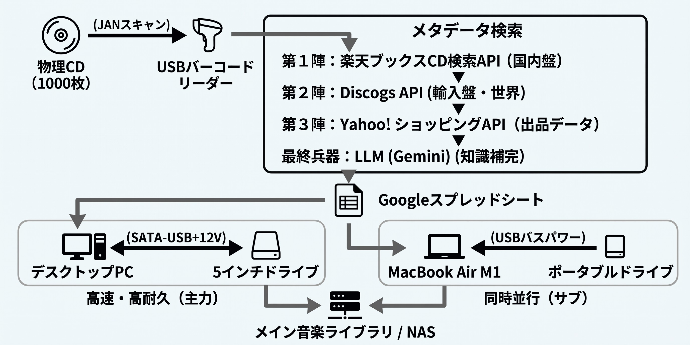
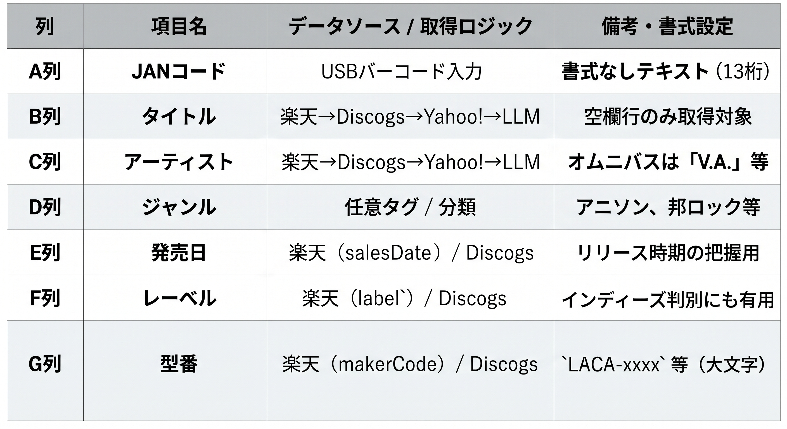
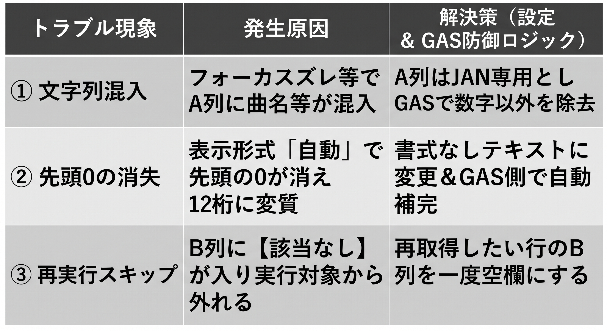
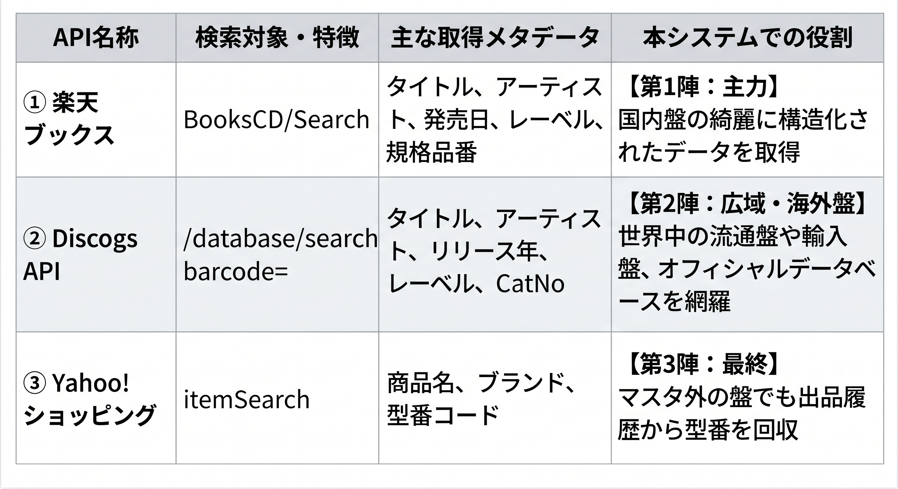
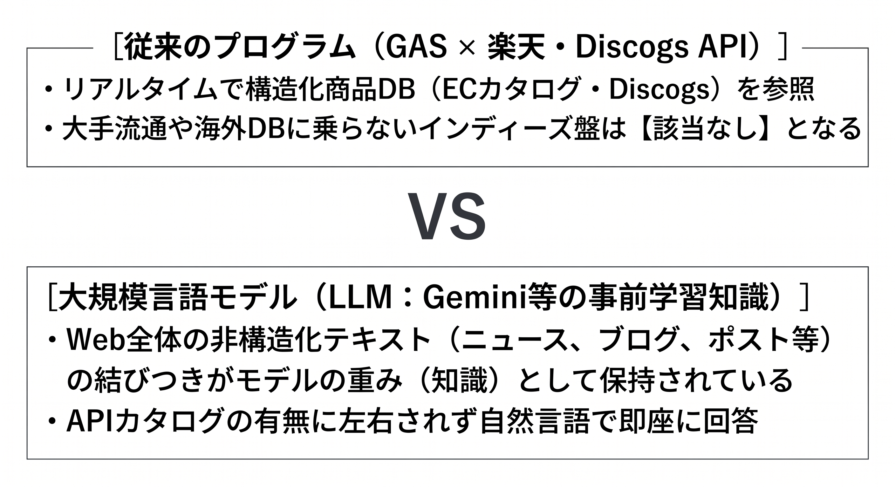
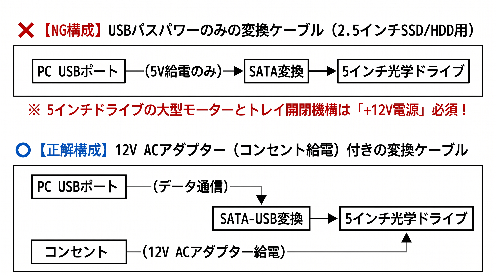
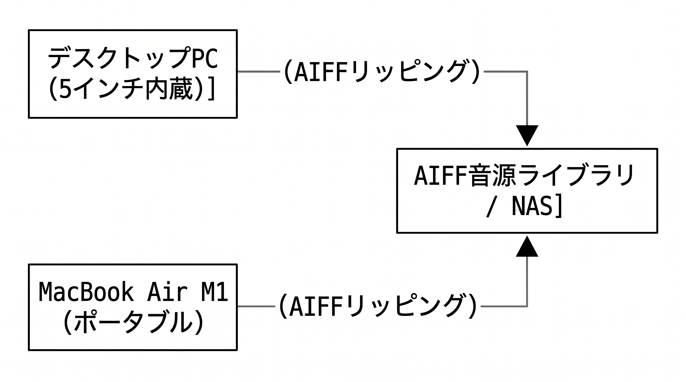

# LLM×GAS×ハードオフで作る！物理CD 1,000枚の完全自動ライブラリ化＆AIFF爆速リッピング実践記

**〜バーコードリーダー連携・3大API（楽天・Yahoo!・Discogs）多段連携・インディーズ盤のLLM補完からPC＆Mac 2台体制の並列リッピングまで〜**

## 第1節：はじめに —— なぜ今、物理CD 1,000枚を「AIFF＋スプレッドシート」で完全管理するのか

はじめまして。東京や群馬でアニソンを中心にDJをしております、よしおと申します。

今回のプロジェクトを立ち上げた最大のきっかけは、「引っ越し」と「自宅へのNAS（ネットワーク対応HDD）の導入」だった。引っ越しを終えて新居を見渡すと、部屋の隅には長年集めてきた大量のCDが詰まった段ボール箱がいくつも鎮座していた。

音楽ストリーミングサービスが全盛を迎えた現在でも、手元の棚に眠る「物理CD」の価値は決して失われていない。特に2000年代〜2010年代の深夜アニメ主題歌や劇伴、邦楽インディーズロック、アイドル盤、ライブ会場限定盤、そしてレーベル独自のコンピレーションアルバムなどは、サブスクリプションサービスで未配信のものが数多く存在する。また、DJプレイや高音質なホームリスニング環境において、非圧縮かつメタデータ（曲名・アーティスト名・ジャケット画像）をファイル自体に安全に保持できる **AIFF（Audio Interchange File Format）** 形式で音源をリッピングし、体系的に管理することには大きな実用上のメリットがある。

だからこそ、せっかく自宅にNASを導入したこのタイミングで、段ボールの中に眠るCDをすべてAIFF形式でデジタルアーカイブ化してNASへ集約し、物理的なCD自体は整理・処分して部屋のスペースを空けようと思い立ったのである。

しかし、当初500枚程度と見込んでいた段ボールの中の物理CDを実際にすべて洗い出してみると、最終的には倍の **1,000枚** に達していた。この1,000枚のCDをいざデジタル化し、同時に「自分が何を所有していたのか」「どのレーベルの何という型番なのか」を後から振り返れるよう台帳化しようとすると、絶望的な手作業の壁が立ちはだかる。

### 手作業で1,000枚を処理した場合の試算

* **台帳入力：** 1枚あたり3分 × 1,000枚 ＝ **約50.0時間**

* **CDリッピング：** 1枚あたり4分 × 1,000枚 ＝ **約66.7時間**

* **合計所要時間：** **約116.7時間（1日2時間で約2ヶ月）**

この苦行を最小限のコストと最短の時間で突破するために筆者が実践したのが、**「USBバーコードリーダー × Googleスプレッドシート（GAS：楽天・Yahoo!・Discogs API連携） × LLM（Gemini） × デスクトップPC（5インチ内蔵ドライブ）＆ MacBook Air M1（ポータブルドライブ）の2台並列体制」** を組み合わせた自動化パイプラインである。

本稿では、LLMを「単なるコード生成ツール」として使うだけでなく、**APIトラブルの壁打ち相手、インディーズ盤のロングテール知識データベース、ハードウェア選定のアドバイザー**としてフル活用し、1,000枚のCDライブラリ管理＆爆速リッピングを完遂した全貌を共有する。

## 第2節：システム全体アーキテクチャとデータベース設計

まずは、今回構築したCD管理・リッピングシステムの全体像を図解する。作業は大きく **「① 3大API＋LLMによるメタデータ台帳化ストリーム」** と **「② 物理ディスクのAIFF高速リッピングストリーム」** の2本柱で構成される。

### 【図解1】CDライブラリ自動化＆並列リッピング 全体アーキテクチャ



<div style="break-before: page;"></div>

### スプレッドシートのテーブル（列）設計

Googleスプレッドシートは、A列にバーコードリーダーでJANコードを流し込むだけで、B列〜G列のCDメタデータが自動充填される設計とした。



## 第3節：入力インターフェース構築 —— バーコードリーダーと「先頭ゼロ消失問題」の罠

1,000枚のCDのJANコード（13桁の数字）を手打ちするのは論外である。ここではハードウェアのバーコードリーダー（**IO DATA BR-CCD/TS2K**）を導入した。USBで接続するだけでキーボードエミュレータ（HID）として認識され、バーコード読取後に自動で「Enter（改行）」が送信されるため、スプレッドシート上でA2セル、A3セル……と連続スキャンができる。

しかし、実際に運用を開始した直後、**「スクリプトを実行してもまったくデータが取得できない」** という壁にぶつかった。解析の結果、スプレッドシート特有の「3つの罠」が判明した。

### 【図解2】スプレッドシート入力時に発生する3大トラブルと対策



特に厄介だったのが **②の「先頭ゼロ消失によるHTTP 400エラー」** だ。輸入盤等で先頭が「0」から始まるケースがあり、スプレッドシートのデフォルトでは12桁に削られてしまう。これを根絶するため、シートのA列を書式なしテキストに設定した上で、GAS側に自動補完ロジックを組み込んだ。

```javascript
// 先頭の「0」が消えて12桁になった場合、自動で補完
if (janCode.length === 12) {
  janCode = '0' + janCode;
  sheet.getRange(rowNum, 1).setValue("'" + janCode);
}
```

このように、「人間やスプレッドシートの仕様ミスをコード側で吸収する」防御的プログラミングをLLMと対話しながら即座に実装できるのが、現代の個人開発の醍醐味である。

## 第4節：3大API（楽天・Discogs・Yahoo!）の導入と多段フォールバック設計のリアル

1,000枚のCDには、最新アニソンから絶版サントラ、海外盤や輸入インディーズ盤まで多様な盤が含まれる。国内盤に強い楽天ブックスAPIだけではカタログ漏れが生じるため、世界中の音楽データベースを網羅する **Discogs API** と **Yahoo!ショッピングAPI** を組み合わせた多段構成へと進化させた。

### 【図解3】3大APIの特徴と役割分担




### 4.1 楽天APIの登録とDiscogs APIの認証トークン設定

国内盤をカバーする楽天ブックスAPIに加え、世界中のマスタを持つ **Discogs API** を導入するにあたり、Discogs公式サイトのDeveloper設定から「Personal Access Token」を発行した。Discogs APIはリクエストヘッダーにユーザーエージェント（User-Agent）と認証トークンを指定する必要があり、これによって信頼性の高いグローバルなリリース情報を取得できるようになる。

### 【図解4】Discogs API利用時のGASリクエスト設定例

```javascript
// Discogs Database Search エンドポイントの呼び出し例
const url = `https://api.discogs.com/database/search?barcode=${janCode}&type=release`;
const options = {
  method: 'get',
  headers: {
    'User-Agent': 'CDLibraryManager/1.0',
    'Authorization': 'Discogs token=あなたのアクセストークン'
  },
  muteHttpExceptions: true
};
```

このように、国内の楽天ブックスAPIでカバーしきれない輸入盤や古い規格のCDを、Discogsの強大なバーコード検索データベース（`/database/search?barcode=`）で広範囲にキャッチできる堅牢なパイプラインが完成した。

## 第5節：最大の壁「インディーズ・自主制作CD問題」とLLMハイブリッド解決法

3大API連携が開通し、メジャー盤や輸入盤のメタデータが次々と埋まっていく中、ある1枚のCDのバーコードをスキャンしたところで **`【該当なし】`** が表示された。インディーズ盤や自主制作CDは、Discogsのグローバルデータベースにも登録されていないことがある。

しかし、デバッグのためにGeminiのチャット画面に `4582237828221` を打ち込んだところ、**・「『とんちこんぴ』ですね！」** と即座に返答があった。

### 【図解5】従来のAPI検索とLLMの知識検索の構造的違い



つまり、APIの「整備された高速道路」からはみ出した自主制作CDの情報であっても、インターネットの片隅にあるブログ等のテキストには刻まれており、LLMはその **「Webのロングテールな記憶」** を保持しているのだ。

<div style="break-before: page;"></div>

### 5.1 結論：ハイブリッド運用の確立

1. **フェーズ1：** バーコード連続スキャン ＆ GAS実行（全体の80〜90%を自動化）

2. **フェーズ2：** `【該当なし】` となったインディーズ盤のJANだけを抽出してLLMへ一括投稿

3. **フェーズ3：** LLMが出力したTSV形式の表をスプレッドシートへコピペ反映

「定型処理はGASに任せ、こぼれ落ちた非定型データはLLMに任せる」。これこそが実用的なAI活用アーキテクチャである。

## 第6節：ハードウェアハック編 —— デスクトップPC×MacBook Air M1の2台体制で1,000枚をAIFF爆速リッピングする

台帳システム完成後、次は物理的な「CD 1,000枚のAIFFリッピング」である。

### 6.1 1,000枚の物量に立ち向かうための「5インチ内蔵ドライブ」導入

CDを数枚取り込むだけなら手持ちの薄型ポータブルドライブ1台で十分だが、最終的に **1,000枚** に膨れ上がったコレクションをポータブルドライブ1台だけで処理しようとすると、以下の限界に直面する。

* **連続稼働による発熱と速度低下：** 10枚、20枚と連続でリッピングし続けると筐体内部に熱がこもり、サーマルスロットリングのように回転数が落ちていく。
* **ピックアップレンズとモーターの耐久性：** 華奢な機構のため、1,000枚の連続稼働では途中でドライブ自体が寿命を迎えるリスクが高い。
* **傷盤・中古盤の読み取り精度：** 中古で集めたCDや長年現場で使ったCDの細かい傷に対し、薄型ドライブはエラー補正が効かずリッピングが止まりやすい。

そこで主力機として導入したのが、**「ハードオフのジャンク・中古コーナーでデスクトップPC用の『5インチ内蔵光学ドライブ』を調達し、SATA-USB変換アダプターで外付け化する」** というハードウェアハックだ。ハードオフにて、LG製の定番5インチSATA内蔵ドライブ **『GH24NS95』** を格安で入手し、メインのデスクトップPCへ接続した。大型モーターと余裕のある筐体設計を持つ5インチ内蔵ドライブは、読み取り速度・耐久性・傷盤への強さのすべてにおいて圧倒的な安定感を誇る。

### 6.2 ⚠️ 最大の落とし穴：「12V電源問題」に気をつけろ！

5インチ内蔵ドライブ（`GH24NS95`）をSATA-USB変換ケーブルでデスクトップPCに外付け接続する際、**絶対にやってはいけない失敗**がある。それは「2.5インチSSD/HDD用の安価なSATA-USB変換ケーブル（USBバスパワーのみで動く1,000円前後のもの）」を買ってしまうことだ。

### 【図解6】SATA-USB変換アダプターの「5V / 12V電源」仕様差（超重要）



筆者はLLMとの事前相談によりこの「12V電源の罠」を回避し、**AC電源付きのSATA-USBケーブル**を購入してデスクトップPCに `LG GH24NS95` を接続した。これにより、ケースを開けて内蔵配線を取り回す手間なく、デスク上で手軽に5インチドライブのフルパワーを引き出すことができた。

### 6.3 「デスクトップPC ＋ MacBook Air M1」の2台マシン並列体制による1,000枚攻略

1,000枚のCDを1枚あたり平均3〜4分で取り込む場合、ドライブ1台では **約66.7時間** かかり、CDが回転している間の3分間、人間は画面の前で手持ち無沙汰な「待ち時間」を過ごすことになる。
一方で、1台のPCに2台のドライブを繋ごうとすると、**「iTunes（ミュージックアプリ）は仕様上、同時に1台のドライブしかリッピング処理を実行できない」** というソフトウェア上の排他制限にぶつかる。
そこで筆者が最終的に採用した実践構成が、**「デスクトップPC（5インチ内蔵ドライブ＋AC電源付きSATA-USBケーブル）」と「MacBook Air M1（ポータブルCDドライブ接続）」の2台のマシンを並べて同時に回すハイブリッド2台体制** である。


### 【図解7】デスクトップPC × MacBook Air M1 による2台並列リッピング実戦フロー



この2台体制により、**「①両マシンのリッピング中に ➔ ②バーコードスキャンでGAS＆LLM台帳を埋める」** という待ち時間ゼロのトリプル並行ループが確立され、1,000枚のアーカイブを完走できた。

<div style="break-before: page;"></div>

## 第7節：おわりに —— LLM時代の個人ライフハック開発論と今後の展望

今回のプロジェクトを通じて痛感したのは、**「LLMは単なるコード生成器ではなく、ソフトウェア・知識ベース・ハードウェアを横断する総合エンジニアリングの相棒である」** ということだ。

* APIエラーが起きたとき、エラーコードから「スプレッドシートの先頭ゼロ消失」や「API制限仕様」を即座に特定し、楽天・Discogs・Yahoo!の3大API連携へと導くデバッグ力。

* どの公式APIにも載っていないインディーズ盤（『とんちこんぴ』）のJANコードを、事前学習されたWebの記憶から一発で引き当てる知識補完力。

* 「ハードオフで5インチ内蔵ドライブ（`LG GH24NS95`）を買ったのだが、どのUSBケーブルを買えばいいか？」という問いに対し、「5Vバスパワーケーブルでは動かない、必ず12V ACアダプター付きを選べ」と物理層の事故を未然に防ぐハードウェア知識。

また、今後の発展課題として **「取得したCDメタデータをもとに、Spotifyなどのサブスクで配信されているかを自動判定する仕組み」** の導入を考えている。これにより、「いつでも聴けるから手放すCD」と「サブスク未配信のため絶対に手元に残すCD」の仕分け判断まで自動化したい。

> **💡 完全統合版GASソースコードに関するお知らせ**
> 本稿で解説した「先頭ゼロ自動修復」および「3段階フォールバック検索（楽天・Discogs・Yahoo!）」を実装した完全版GASソースコード（全機能実装済み・エラーハンドリング・署名生成関数を含む全コード）は、紙幅の都合上掲載しておりません。
>
> **完全版のGASソースコードをご希望の方は、著者（よしお）のTwitter（X: @yoshio_dj）までお気軽にDMをいただければ、その場で個別にお渡しいたします！**

部屋の隅の段ボールに眠る大量のメディアの整理に悩んでいる方は、ぜひバーコードリーダーと5インチドライブ、そしてLLMを手元に置いて、最強のアーカイブ環境を構築してみてほしい。